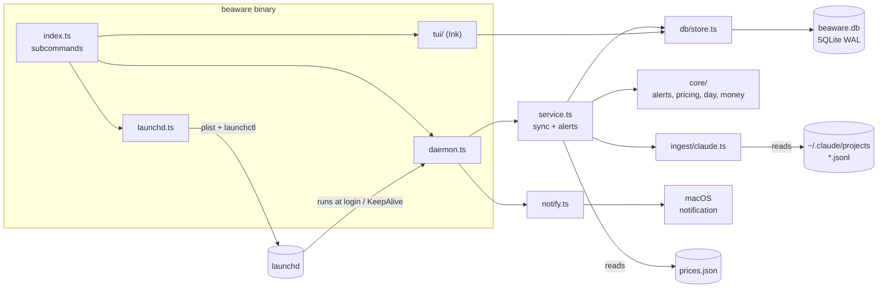
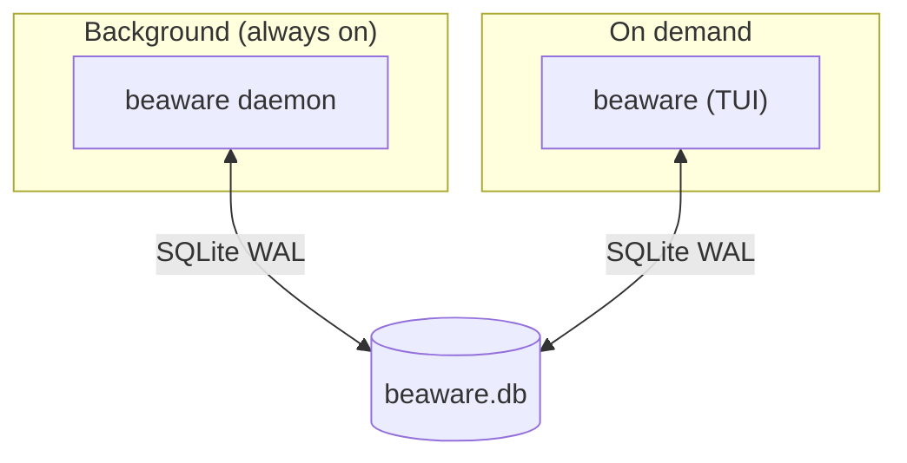

# Architecture

One binary, three roles.

## Modules

| Path                   | Role                                                        |
|------------------------|-------------------------------------------------------------|
| `src/index.ts`         | CLI entry, dispatches subcommands                           |
| `src/daemon.ts`        | tick loop, heartbeat, single-instance guard                 |
| `src/service.ts`       | `createSyncer`, `checkAlerts`, `updateSettings` (use-cases) |
| `src/ingest/claude.ts` | incremental JSONL reader                                    |
| `src/core/*`           | pure logic: milestones, pricing, day buckets, money         |
| `src/db/store.ts` | facade: one entry point, delegates to repositories |
| `src/db/config.ts`, `schema.ts` | open DB (pragmas, WAL), create tables |
| `src/db/repositories/*` | one file per entity; all SQL lives here |
| `src/notify.ts`        | OS notification command                                     |
| `src/launchd.ts`       | install/uninstall, plist generation                         |
| `src/tui/*`            | App, Dashboard, Settings, AddSpend                          |

## Boundaries

- `core/` is pure (no IO) → easy to test
- Only `src/db/` runs SQL; callers use `Store`
- TUI and daemon never talk directly; they share the DB (+ heartbeat)

## Process view

