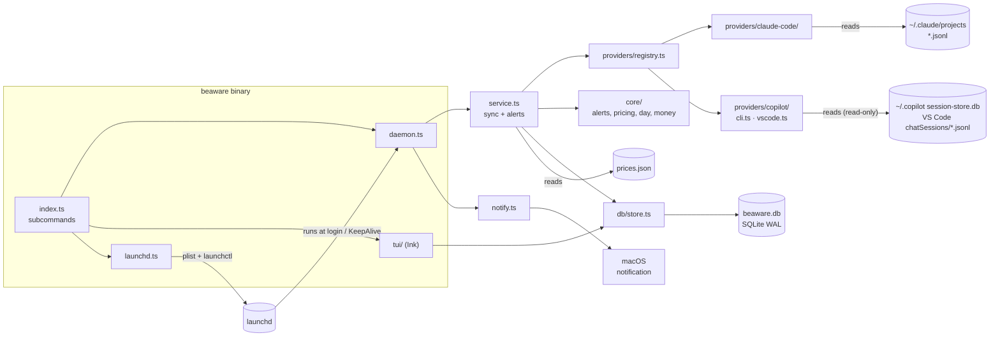
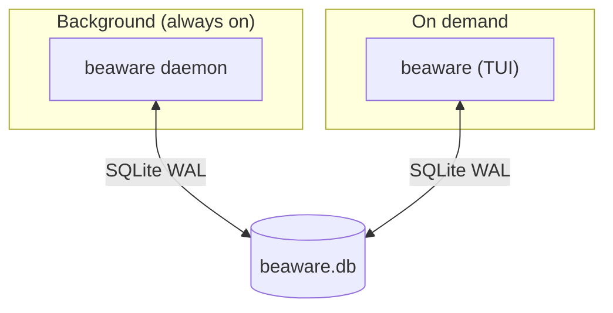

# Architecture

One binary, three roles.

## Modules

| Path                            | Role                                                        |
|---------------------------------|-------------------------------------------------------------|
| `src/index.ts`                  | CLI entry, dispatches subcommands                           |
| `src/daemon.ts`                 | tick loop, heartbeat, single-instance guard                 |
| `src/service.ts`                | `createSyncer`, `checkAlerts`, `updateSettings` (use-cases) |
| `src/providers/types.ts`        | `Provider` / `Source` interfaces                            |
| `src/providers/registry.ts`     | the only file that lists providers                          |
| `src/providers/<id>/`           | one self-contained folder per provider (paths, parse, ingest, prices, `index.ts`) |
| `src/providers/breakdown.ts`    | pure: per-provider shares and accuracy tags for the dashboard |
| `src/core/*`                    | pure logic: milestones, pricing, day buckets, money         |
| `src/db/store.ts`               | facade: one entry point, delegates to repositories          |
| `src/db/config.ts`              | open DB (pragmas, WAL), run migrations                      |
| `src/db/retention.ts`           | retention constants, `keepFrom`, `shouldPrune` (pure)       |
| `src/db/migrations/*`           | numbered, append-only schema steps (`PRAGMA user_version`)  |
| `src/db/repositories/*`         | one file per entity; all SQL lives here                     |
| `src/notify.ts`                 | OS notification command                                     |
| `src/launchd.ts`                | install/uninstall, plist generation                         |
| `src/tui/App.tsx`, `AddSpend.tsx` | screen switching, key handling, add-spend form            |
| `src/tui/dashboard/`            | `Dashboard` composes small parts: header, today's spend, provider bars, next alert, status rows, banner, warnings, key hints |
| `src/tui/settings/`             | `Settings` renders; `useSettingsScreen` holds the state and keys; `items.ts` lists rows and formats values |
| `src/tui/components/`           | shared: `Panel`, `Section`, `ProgressBar`                   |

## Boundaries

- A provider is a folder under `src/providers/` implementing `Provider`; `service.ts` only knows the registry, never a provider by name
- Providers write through `Store` (`upsertEvent`, cursors); they never run SQL
- Providers never import each other, the TUI or `service.ts`

- `core/` is pure (no IO) → easy to test
- Only `src/db/` runs SQL; callers use `Store`
- TUI and daemon never talk directly; they share the DB (+ heartbeat)

## Process view

