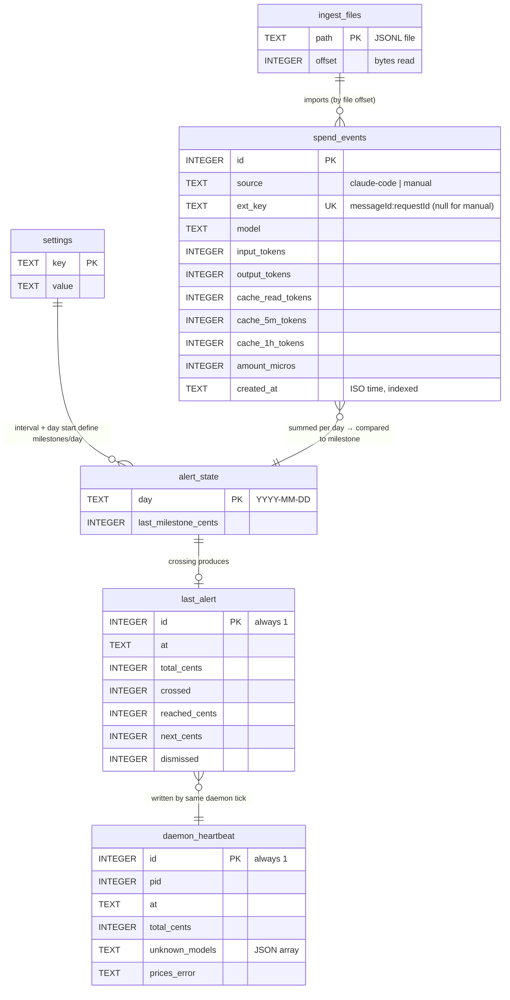

# Data model

SQLite at `~/.config/beaware/beaware.db`. Schema created idempotently in `Store`'s constructor.

| Table              | Purpose                                                                                             |
|--------------------|-----------------------------------------------------------------------------------------------------|
| `spend_events`     | one row per Claude response (`source=claude-code`, unique `ext_key`) or manual add; `amount_micros` |
| `settings`         | key/value: `alert_enabled`, `alert_interval_cents`, `day_start_hour`, `synced_once`                 |
| `alert_state`      | per-day high-water milestone (`day`, `last_milestone_cents`)                                        |
| `ingest_files`     | byte offset per JSONL file (incremental reads)                                                      |
| `daemon_heartbeat` | single row: pid, time, total, warnings                                                              |
| `last_alert`       | single row: latest alert + `dismissed` flag                                                         |

## ER diagram

No foreign keys are declared; relationships are logical (derived at query time).

## Conventions

- Money: integer **micro-dollars** (1¢ = 10,000); totals floor to cents
- `ext_key = messageId:requestId`; last log line for a message wins
- Day = local time from `dayStartHour`, key `YYYY-MM-DD`
- Other files: `prices.json` (same dir), log `~/Library/Logs/beaware/daemon.log`
