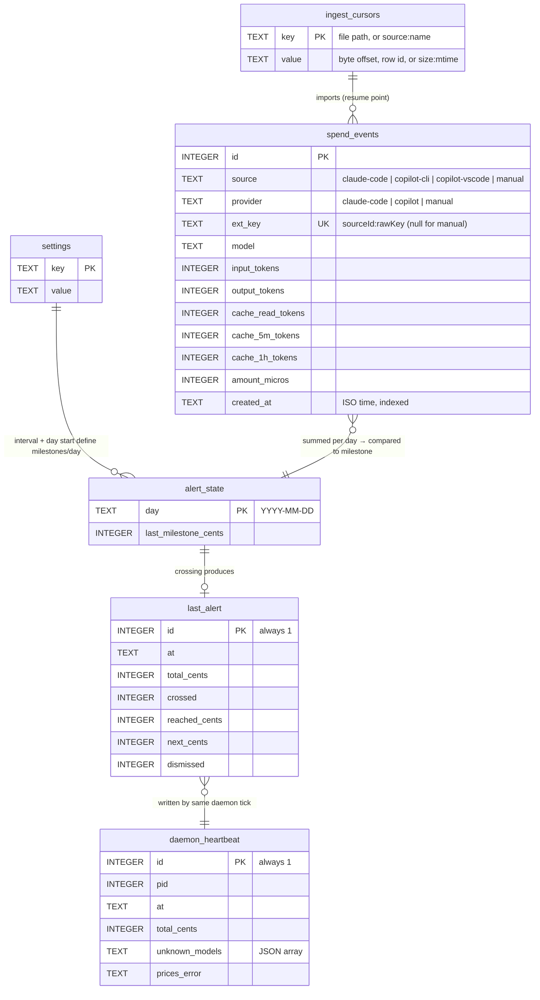

# Data model

SQLite at `~/.config/beaware/beaware.db`. The schema is built by numbered migrations (`src/db/migrations/`, tracked with `PRAGMA user_version`) that run when the database is opened.

| Table              | Purpose                                                                                             |
|--------------------|-----------------------------------------------------------------------------------------------------|
| `spend_events`     | one row per model response/call (`source` = which ingester, `provider` = which tool, unique `ext_key`) or manual add; `amount_micros` |
| `settings`         | key/value: `alert_enabled`, `alert_interval_cents`, `day_start_hour`, `synced_once:<providerId>`    |
| `alert_state`      | per-day high-water milestone (`day`, `last_milestone_cents`)                                        |
| `ingest_cursors`   | opaque `key → value` progress per ingester (file path → byte offset, `copilot-cli:last_id` → row id) |
| `daemon_heartbeat` | single row: pid, time, total, warnings                                                              |
| `last_alert`       | single row: latest alert + `dismissed` flag                                                         |

## ER diagram

No foreign keys are declared; relationships are logical (derived at query time).

## Conventions

- Money: integer **micro-dollars** (1¢ = 10,000); totals floor to cents
- `ext_key = <sourceId>:<rawKey>`; the last write for a key wins. Raw keys: Claude `messageId:requestId`, Copilot CLI `sessionId:rowId`, VS Code `sessionId:requestId`
- Model ids from Copilot are stored as `copilot/<model>` (also the `prices.json` key)
- Only `claude-code` and `copilot-vscode` rows are token-priced and repriced; `copilot-cli` rows keep Copilot's reported cost (nano-AIU → micro-dollars, `providers/copilot/aiu.ts`)
- Copilot rows reuse the token columns: `cache_5m_tokens` holds cache *writes*; CLI `input_tokens` is stored net of cached tokens so columns don't overlap
- Accuracy (`est.`/`reported`) is not stored; it's declared per source in code
- Schema changes: append a numbered file to `src/db/migrations/` and to `MIGRATIONS` in `index.ts`; never edit an existing step
- Day = local time from `dayStartHour`, key `YYYY-MM-DD`
- Other files: `prices.json` (same dir), log `~/Library/Logs/beaware/daemon.log`
