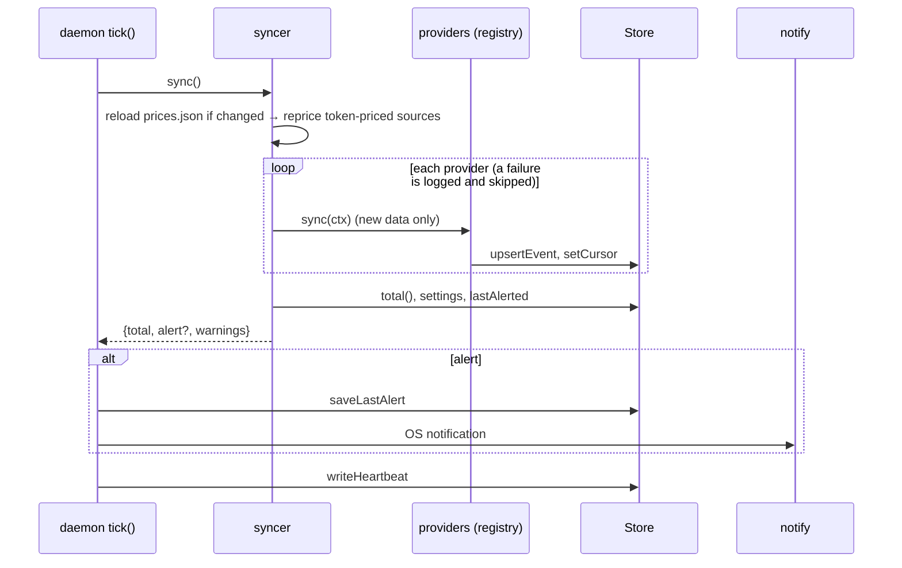
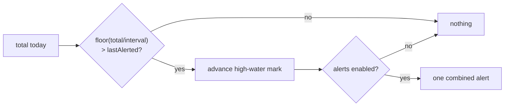
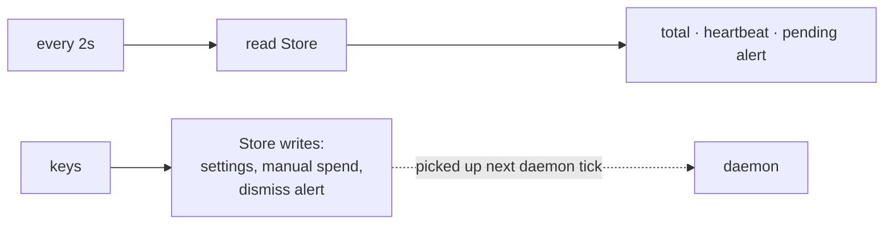
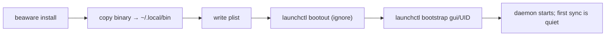
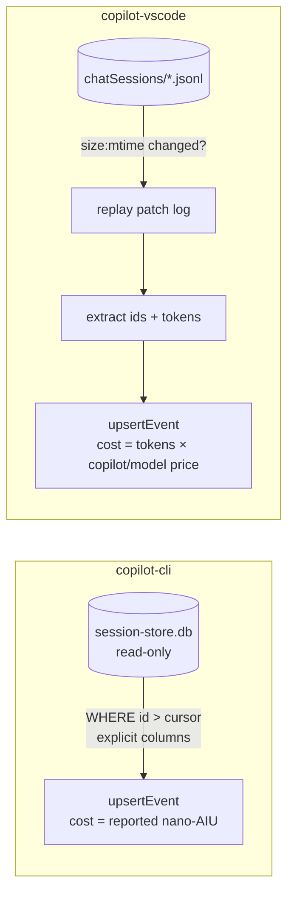

# Flows

## 1. Daemon tick (every 10s)

## 2. Alert decision (`core/alerts.ts`)

High-water mark advances even when disabled → no replay.

## 3. TUI

Alive = heartbeat younger than 30s.

## 4. Settings change
TUI → `updateSettings` → `Store.saveSettings`. If interval or day-start changed → rebaseline (no alert). Daemon reads settings fresh each tick (no cache).

## 5. Install

## 6. First sync
Per provider (`synced_once:<providerId>`): imports the last 7 days, sets the baseline to the current milestone, fires nothing. A provider added later (e.g. Copilot after an update) gets its own quiet first sync, so its history can't cause an alert. Side effect: an alert that would have been raised by *another* provider in that same tick is absorbed into the new baseline.

## 7. Copilot sources

The two sources run independently; one failing doesn't hide the other.
