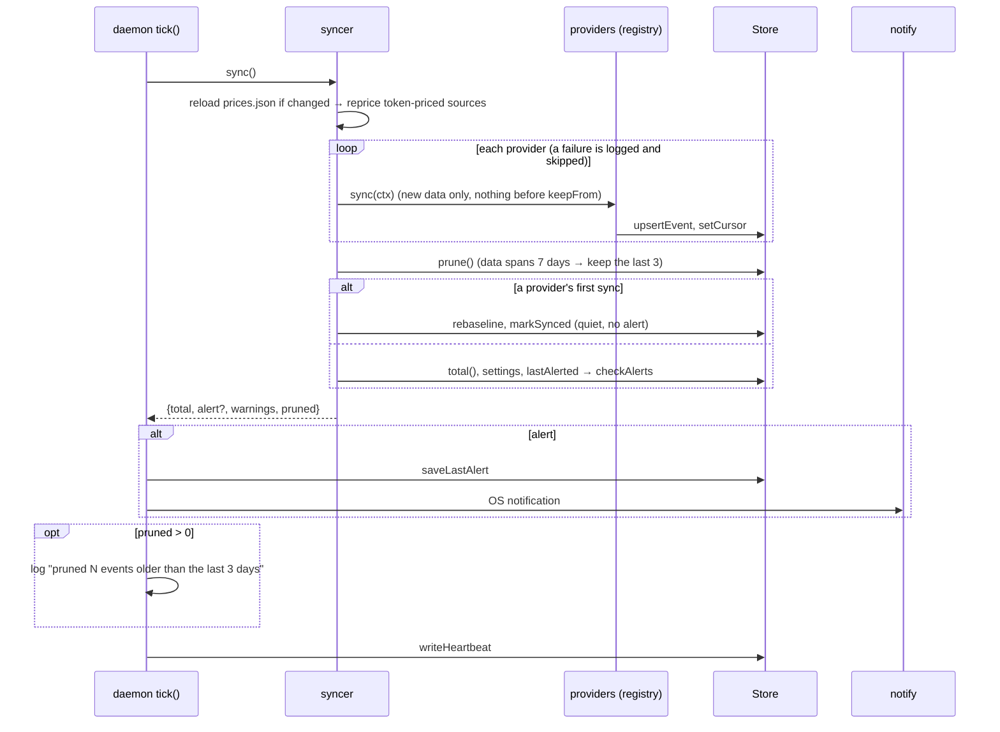
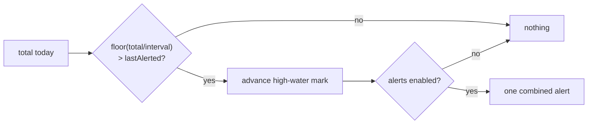
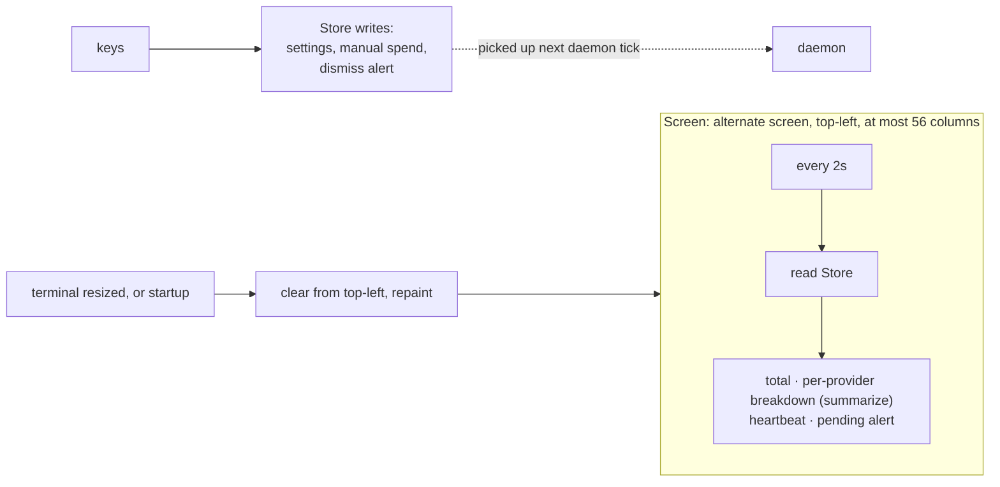
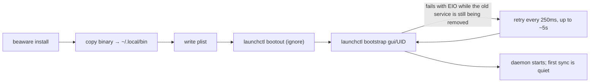
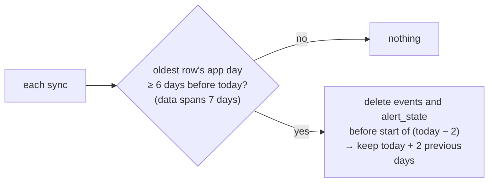
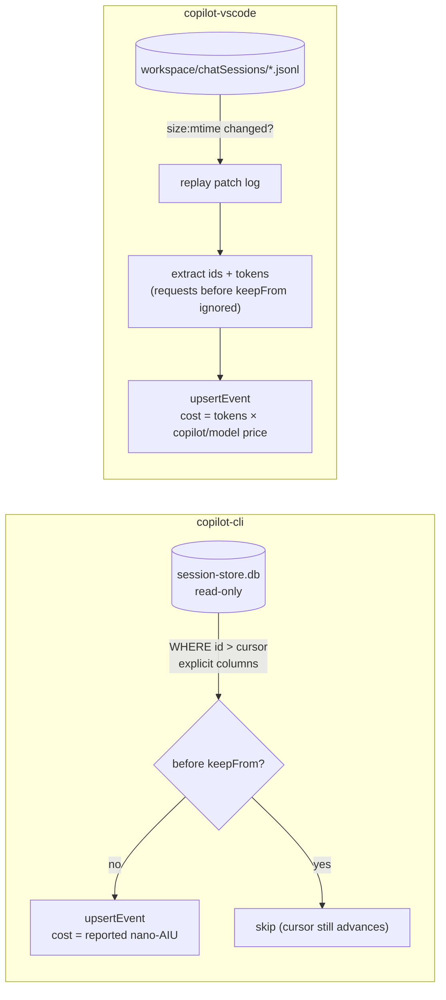

# Flows

## 1. Daemon tick (every 10s)

## 2. Alert decision (`core/alerts.ts`)

High-water mark advances even when disabled → no replay.

## 3. TUI

Alive = heartbeat younger than 30s. `Screen` is the only reader of terminal size; it caps the width and `Panel` derives bar widths from it. Startup also repaints from the top-left because entering the alternate screen leaves the cursor where the shell prompt was.

## 4. Settings change
TUI → `updateSettings` → `Store.saveSettings`. If interval or day-start changed → rebaseline (no alert). Daemon reads settings fresh each tick (no cache).

## 5. Install

## 6. First sync
Per provider (`synced_once:<providerId>`): imports the last 3 days (the kept days), sets the baseline to the current milestone, fires nothing. A provider added later (e.g. Copilot after an update) gets its own quiet first sync, so its history can't cause an alert. Side effect: an alert that would have been raised by *another* provider in that same tick is absorbed into the new baseline.

## 7. Retention

One boundary, `keepFrom(now, dayStartHour)` in `src/db/retention.ts`, is shared by pruning and ingestion (`windowStart`). Ingesters ignore anything before it, so a re-read log or a replayed chat session can't bring a deleted row back. Pruning is calendar-based and runs in one transaction; the daemon logs a line only when rows were deleted. The two numbers are constants (`PRUNE_AT_DAYS`, `KEEP_DAYS`), not settings.

## 8. Copilot sources

The two sources run independently; one failing doesn't hide the other.
